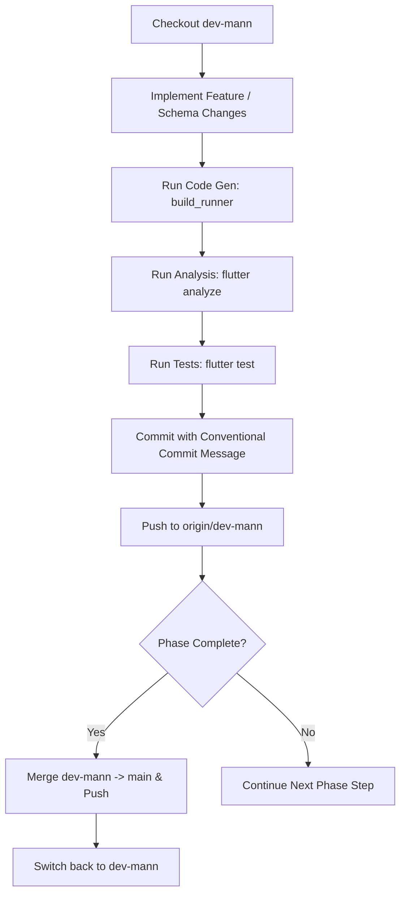

# Revolt Project - Best Git & Development Workflow

This document outlines the standard, best-practice development lifecycle for the Revolt ecosystem (`revolt_data`, `revolt_ble_sdk`, `revolt_ble_toolkit`).

---

## 1. Branching Strategy

| Branch | Purpose | Protection / Rules |
| :--- | :--- | :--- |
| `main` | Production-ready, stable code. | Always builds cleanly with 0 analysis issues and passing unit tests. |
| `dev-mann` | Active feature integration branch. | Core development for Phase tasks. |
| `feat/<feature-name>` | Isolated feature work (optional). | Merges into `dev-mann` when completed. |

---

## 2. Feature Development Lifecycle



---

## 3. Mandatory Pre-Commit Checklist

Before committing any changes:

1. **Code Generation** (if Drift / Freezed / Riverpod models changed):
   ```bash
   dart run build_runner build --delete-conflicting-outputs
   ```
2. **Static Analysis**:
   ```bash
   flutter analyze
   ```
   *Rule: 0 errors and 0 warnings allowed.*

3. **Automated Unit & Database Tests**:
   ```bash
   flutter test
   ```

---

## 4. Conventional Commit Standards

Commit messages must follow the standard format:
- `feat(scope): description` for new features or schema updates (e.g., `feat(rides): add source column to RidesTable`)
- `fix(scope): description` for bug fixes
- `chore(scope): description` for build runner, configuration, or documentation updates

---

## 5. Phase Completion & Merge Workflow

When a Phase or sub-phase is complete and validated:

```bash
# 1. Ensure dev-mann is pushed and clean
git status

# 2. Checkout main and pull latest
git checkout main
git pull origin main

# 3. Merge dev-mann into main
git merge dev-mann -m "Merge dev-mann: <Phase Description>"

# 4. Push updated main to GitHub
git push origin main

# 5. Switch back to dev-mann for next task
git checkout dev-mann
```
