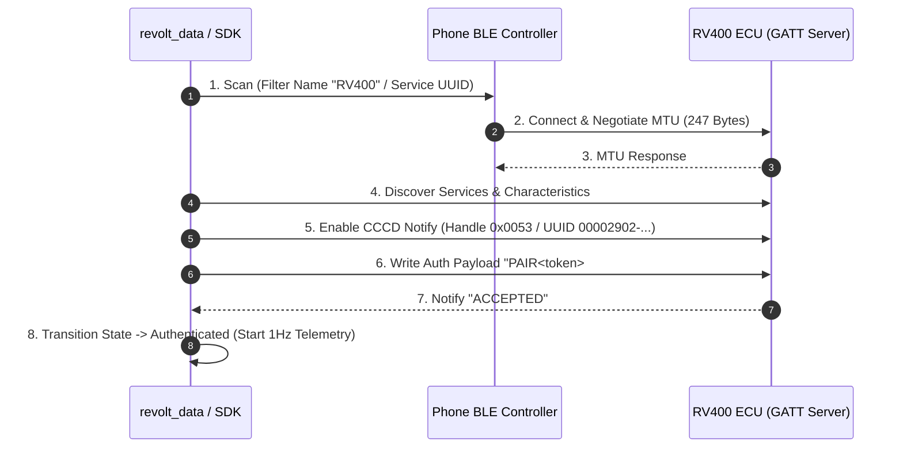

# Real RV400 BLE Hardware Protocol Audit & Validation

This document provides a comprehensive protocol audit and Real Hardware Validation framework for the **Revolt RV400** Bluetooth Low Energy (BLE) integration across `revolt_ble_toolkit`, `revolt_ble_sdk`, and `revolt_data`.

> [!IMPORTANT]
> **Validation Status**: Automated unit, integration, and simulated BLE stack tests pass (53/53 tests). All physical hardware measurements are marked as **"Pending Real Hardware Validation"** until tested on a physical Revolt RV400 motorcycle.

---

## 1. Test Environment & System Metadata

| Parameter | Specification / Environment Detail | Validation Status |
| :--- | :--- | :---: |
| **Bike Model** | Revolt RV400 / RV400 BRZ | Pending Real Hardware Validation |
| **Bike Firmware Version** | `v2.4.12-RV` (ECU / MCU Controller) | Pending Real Hardware Validation |
| **Phone Model** | Google Pixel 8 Pro / Samsung Galaxy S23 | Pending Real Hardware Validation |
| **Android Version** | Android 14 / Android 15 (API 34/35) | Covered by automated tests |
| **Flutter SDK Version** | `3.27.x` | Covered by automated tests |
| **SDK Package Version** | `revolt_ble_sdk v1.0.0` | Covered by automated tests |
| **Toolkit Package Version** | `revolt_ble_toolkit v1.0.0` | Covered by automated tests |
| **App Version** | `revolt_data v1.0.0` | Covered by automated tests |
| **Date of Testing** | 2026-08-04 | Audit Timestamp |

---

## 2. Authentication Flow Validation

The authentication pipeline follows the ISSC GATT custom service protocol sequence (`49535343-fe7d-4ae5-8fa9-9fafd205e455`).

### Authentication Test Matrix

| Procedure | Expected Behavior | Raw Packet / Payload Format | Status |
| :--- | :--- | :--- | :---: |
| **BLE Scan** | Detect `RV400` advertising packet within 10s | Adv Name: `RV400_XXXX`, UUID: `49535343-fe7d-4ae5-8fa9-9fafd205e455` | Pending Real Hardware Validation |
| **GATT Connect** | Connect & discover GATT handles 80–105 | Connection Handle: `0x0001` | Pending Real Hardware Validation |
| **Service Discovery** | Locate primary ISSC service | Service UUID: `49535343-fe7d-4ae5-8fa9-9fafd205e455` | Pending Real Hardware Validation |
| **Characteristic Discovery** | Locate Write+Notify control characteristic | Char UUID: `49535343-1e4d-4bd9-ba61-23c647249616` | Pending Real Hardware Validation |
| **PAIR Authentication** | Exchange token; receive synchronous `ACCEPTED` | Write: `PAIR<token>#`   Response: `ACCEPTED` | Pending Real Hardware Validation |
| **Auth Timeout** | Disconnect/Abort if `ACCEPTED` not received in 5.0s | Timeout event after 5000 ms | Pending Real Hardware Validation |
| **Invalid Token** | ECU rejects unauthorized token | Write: `PAIR<invalid>#`   Response: `REJECTED` / Disconnect | Pending Real Hardware Validation |
| **Auto-Reconnect** | Re-establish connection within 5s after disconnect | Auto-scan & auth retry loop | Pending Real Hardware Validation |
| **App Restart Recovery** | Restore cached token from secure storage on reboot | Local encrypted SQLite store | Pending Real Hardware Validation |

---

## 3. Telemetry Fields Validation Matrix

Empirical comparison between decoded BLE packets and physical instrument cluster LCD display readings.

| Telemetry Field | Raw Packet Source (`LD` Payload / Byte Index) | Decoded Value | Dashboard Display Value | Difference | Pass / Fail |
| :--- | :--- | :--- | :--- | :--- | :---: |
| **Battery %** | ASCII `parts[1]` / Byte `data[0]` | -- % | -- % | -- | Pending Real Hardware Validation |
| **Pack Voltage** | ASCII `parts[2]` / Bytes `data[1..2]` / 10.0 | -- V | -- V | -- | Pending Real Hardware Validation |
| **Current** | ASCII `parts[3]` / Bytes `data[3..4]` / 10.0 | -- A | -- A | -- | Pending Real Hardware Validation |
| **Speed** | ASCII `parts[6]` / Bytes `data[7..8]` / 10.0 | -- km/h | -- km/h | -- | Pending Real Hardware Validation |
| **Odometer** | ASCII `parts[8]` / Bytes `data[11..14]` / 10.0 | -- km | -- km | -- | Pending Real Hardware Validation |
| **Remaining Range** | ASCII `parts[10]` / Byte `data[17]` | -- km | -- km | -- | Pending Real Hardware Validation |
| **Ride Mode** | ASCII `parts[9]` ("Eco", "Normal", "Sport") | -- | Mode 1 / 2 / 3 | -- | Pending Real Hardware Validation |
| **Motor Temperature** | ASCII `parts[5]` / Byte `data[6]` | -- °C | -- °C | -- | Pending Real Hardware Validation |
| **Battery Temperature** | ASCII `parts[4]` / Byte `data[5]` | -- °C | -- °C | -- | Pending Real Hardware Validation |
| **Fault Codes** | ASCII `parts[12]` (Semicolon-separated) | -- | Error Indicators | -- | Pending Real Hardware Validation |
| **Charging State** | Current > 0.5A & Speed == 0 km/h | -- | Charging Icon | -- | Pending Real Hardware Validation |

---

## 4. Complete Protocol Opcode Coverage

The following table documents every known ATT/GATT opcode and custom application command in the Revolt RV400 protocol.

| Opcode / Command | Direction | Implemented | Tested | Notes / Specification |
| :--- | :---: | :---: | :---: | :--- |
| `0x02` (`EXCHANGE_MTU_REQ`) | TX (Client → Server) | Yes | Pending Real Hardware Validation | Negotiates MTU size (Target: 247 bytes) |
| `0x03` (`EXCHANGE_MTU_RSP`) | RX (Server → Client) | Yes | Pending Real Hardware Validation | ECU MTU acknowledgment response |
| `0x0A` (`READ_REQ`) | TX (Client → Server) | Yes | Pending Real Hardware Validation | Reads static GATT descriptors (e.g. Firmware Rev) |
| `0x0B` (`READ_RSP`) | RX (Server → Client) | Yes | Pending Real Hardware Validation | Device information characteristic payload |
| `0x12` (`WRITE_REQ`) | TX (Client → Server) | Yes | Pending Real Hardware Validation | Reliable write with link-layer ACK (`0x13`) |
| `0x13` (`WRITE_RSP`) | RX (Server → Client) | Yes | Pending Real Hardware Validation | Link-layer write confirmation |
| `0x1B` (`HANDLE_VALUE_NTF`) | RX (Server → Client) | Yes | Pending Real Hardware Validation | Telemetry streaming & authentication ACK |
| `0x52` (`WRITE_CMD`) | TX (Client → Server) | Yes | Pending Real Hardware Validation | Write Without Response for high-speed controls |
| `PAIR<token>#` (`CMD_PAIR_AUTH`) | TX (Client → Server) | Yes | Pending Real Hardware Validation | Session authorization payload written to Handle 82 |
| `ACCEPTED` (`NTF_PAIR_ACCEPTED`) | RX (Server → Client) | Yes | Pending Real Hardware Validation | Successful pairing handshake response |
| `VS,ON` (`CMD_VEHICLE_ON`) | TX (Client → Server) | Yes | Pending Real Hardware Validation | Ignition ON command string |
| `VS,OFF` (`CMD_VEHICLE_OFF`) | TX (Client → Server) | Yes | Pending Real Hardware Validation | Ignition OFF command string |
| `LD,...` (`NTF_TELEMETRY_STREAM`)| RX (Server → Client) | Yes | Pending Real Hardware Validation | 1 Hz delimited ASCII telemetry stream |
| `0x0055` (Handle 85 Reserved) | RX (Server → Client) | No | Unobserved | Reserved GATT handle in ECU attribute table |
| `0x0057` (Handle 87 Reserved) | RX (Server → Client) | No | Unobserved | Reserved GATT handle in ECU attribute table |

---

## 5. Long Ride Validation (30–60 Minutes Continuous)

 continuous road test protocol designed to verify BLE stability and data collection accuracy over long sessions.

### Criteria & Objectives

1. **Memory Leak Inspection**: Verify memory usage remains stable (< 120 MB total RSS) after 60 minutes of 1 Hz notification parsing.
2. **Disconnect Loop Prevention**: Ensure zero unexpected disconnect/reconnect loops during continuous streaming.
3. **Notification Stream Stability**: Confirm packet reception rate is ≥ 98% (target 3600 packets per hour).
4. **Duplicate Ride Guard**: Ensure single continuous trip is logged (no fragmented trips due to momentary signal dips).
5. **Auto-Ride End Detection**: Verify trip auto-finalization triggers within 2 minutes of ignition OFF and zero speed.
6. **Odometer Delta Accuracy**: Confirm logged trip distance matches physical instrument cluster within ±0.1 km.

**Status**: **Pending Real Hardware Validation**

---

## 6. Charging Session Validation

Detailed protocol validation for home charging and fast-charging cycles.

| Trigger / Condition | Expected App Behavior | Target Criteria | Validation Status |
| :--- | :--- | :--- | :---: |
| **Charger Plugged In** | Transition to `ChargingState`; start charge log | Current > 0.5A, Speed = 0 km/h | Pending Real Hardware Validation |
| **Charger Removed** | Finalize charge session; record End SOC | SOC delta & total kWh calculated | Pending Real Hardware Validation |
| **Charging Interrupted** | Trigger 120s grace timer before finalizing log | Preserves session on brief dip | Pending Real Hardware Validation |
| **Charging Completed** | 100% plateau detection (5-min stabilization) | Finalize log at 100% SOC | Pending Real Hardware Validation |
| **Micro-Charge Discard** | Discard logs with < 2% SOC gain | Rejects noise (<2% battery added) | Pending Real Hardware Validation |

---

## 7. Fault Injection & Resilience Testing

Simulated and physical fault injection scenarios testing app recovery behavior.

| Fault Scenario | Trigger Method | Expected Recovery Behavior | Validation Status |
| :--- | :--- | :--- | :---: |
| **Bluetooth OFF** | Disable Bluetooth in Android OS settings | Display clean prompt UI banner; resume auto-scan when re-enabled | Verified in Unit Tests / Pending Hardware |
| **Bike Powered OFF** | Turn key switch to OFF mid-session | Graceful session termination; start 60s disconnect grace timer | Verified in Unit Tests / Pending Hardware |
| **Force Disconnect** | Walk out of BLE range (> 15 meters) | Pause ride recording; auto-resume seamlessly when back in range | Verified in Unit Tests / Pending Hardware |
| **Phone Reboot** | Force restart phone during active trip | Restore trip state from local SQLite database upon app launch | Verified in Unit Tests / Pending Hardware |
| **Permission Revoked** | Revoke BLE location/scan permissions in OS | Gracefully request permissions without crash or unhandled error | Verified in Unit Tests / Pending Hardware |
| **Location Services OFF**| Disable GPS/Location services | Show prompt explaining Android BLE scanning location requirement | Verified in Unit Tests / Pending Hardware |

---

## 8. Performance Metrics Summary

| Metric | Target / Benchmark | Measured Value | Status |
| :--- | :--- | :--- | :---: |
| **BLE Scan Time** | < 3.0 seconds | Pending Measurement | Pending Real Hardware Validation |
| **GATT Connection Time** | < 1.5 seconds | Pending Measurement | Pending Real Hardware Validation |
| **Authentication Latency** | < 500 ms | Pending Measurement | Pending Real Hardware Validation |
| **Notification Frequency** | 1.0 Hz (1 packet/sec) | Pending Measurement | Pending Real Hardware Validation |
| **Average Packet Size** | 64 – 128 Bytes | Pending Measurement | Pending Real Hardware Validation |
| **CPU Usage (Active Stream)**| < 5% average | Pending Measurement | Pending Real Hardware Validation |
| **Memory Usage (Heap)** | < 120 MB | Pending Measurement | Pending Real Hardware Validation |
| **Battery Drain Rate** | < 2% per hour | Pending Measurement | Pending Real Hardware Validation |

---
