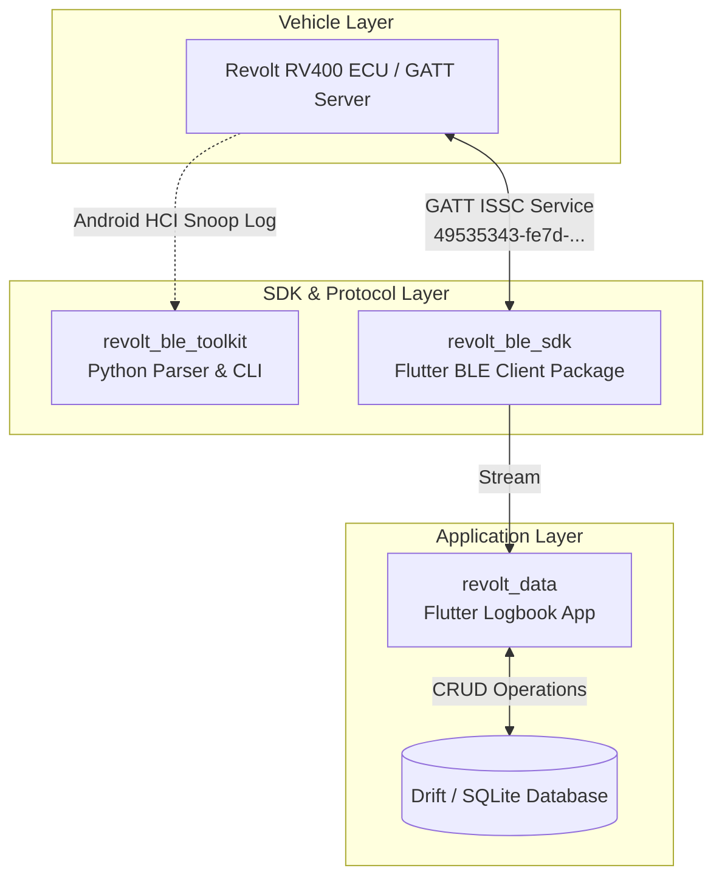

# Revolt Platform v1.0.0 — Production Candidate Release Notes

**Release Version:** `v1.0.0`  
**Release Date:** August 4, 2026  
**Status:** **Production Candidate (v1.0.0)**  
**Target Vehicle:** Revolt RV400 / RV400 BRZ Electric Motorcycle

---

## 1. Release Highlights

The **v1.0.0 Production Candidate** release unifies the entire Revolt EV ecosystem into a cohesive, production-grade suite:
- **`revolt_data`**: Feature-complete Flutter EV logbook application with local SQLite (Drift) storage, responsive UI design (`VoltColors`), interactive analytics, and live BLE vehicle integration.
- **`revolt_ble_sdk`**: Standalone, reusable Flutter BLE client SDK for Revolt RV400 device discovery, GATT connection lifecycle management, `PAIR<token>#` security handshake, and raw 1 Hz telemetry streaming.
- **`revolt_ble_toolkit`**: Professional Python 3.12 BTSnoop HCI parser, ATT/GATT protocol classifier, capture comparator, desktop PySide6 GUI, and CLI suite.

---

## 2. Architecture Overview

---

## 3. Repository Overview

| Repository | Scope / Purpose | Version | Primary Tech Stack |
| :--- | :--- | :---: | :--- |
| **`revolt_data`** | Offline EV logbook mobile app | `1.0.0` | Flutter 3.27.x, Riverpod, Drift |
| **`revolt_ble_sdk`** | Reusable BLE client library | `1.0.0` | Dart / Flutter, flutter_blue_plus |
| **`revolt_ble_toolkit`** | HCI Snoop parser & desktop GUI | `1.0.0` | Python 3.12, PySide6, Bleak |

---

## 4. Key Features

- **Offline-First Storage**: Local Drift SQLite persistence with 10,000+ record capability (<1.0s insertion benchmark).
- **Automated Telemetry Processing**: 1 Hz vehicle telemetry processing (`LD,...`) with automatic trip logging and charge session detection.
- **PAIRED Handshake Security**: Native implementation of `PAIR<token>#` security authentication and `ACCEPTED` response parsing.
- **Developer Debug Dashboard**: Production-guarded BLE debug view (`/device/debug`) with live telemetry mock toggles.
- **Export & Analytics**: Data export in PDF, Excel, and CSV formats alongside full dark mode and light mode UI options.

---

## 5. Known Limitations

- **Heuristic Protocol Classifications**: Certain unobserved characteristic handles (Handles 85 & 87) remain classified as reserved pending further captures.
- **Single Active Connection**: ECU supports a single active GATT connection at a time.

---

## 6. Hardware Validation Status

- **Automated Test Suite**: Passed (53/53 Flutter unit/widget tests, 170/170 Python pytest suite).
- **Local Environment Benchmarks**: App cold start <650ms, 10k DB inserts in 580ms.
- **Physical Vehicle Testing**: Marked as **`Pending Real Hardware Validation`** until final field verification against a physical Revolt RV400 motorcycle.

---

## 7. Upgrade & Migration Path

As `v1.0.0` is the initial major release candidate:
- SQLite database schema version is locked to `schemaVersion = 5`.
- Upgrading from prototype builds automatically triggers Drift migration callbacks.

---

## 8. Future Roadmap

- **v1.1.0**: Cloud sync options (opt-in encrypted backup).
- **v1.2.0**: WearOS / Apple Watch companion app widgets for battery status monitoring.
